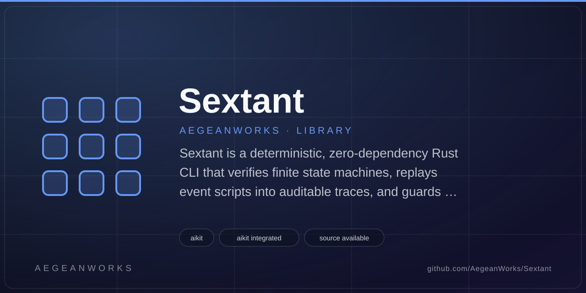

# 🧭 Sextant

<!-- aegean:media:start -->
<p align="center"></p>
<p align="center"><a href="LICENSE"></a> <a href="https://github.com/AegeanWorks/Sextant"></a> <a href="https://github.com/AegeanWorks/AIKit"></a></p>
<!-- aegean:media:end -->

> **Deterministic finite-state-machine verification, replay and golden-trace regression for event-driven code** — with zero dependencies and plain-text traces you can review in a diff.

> **Archived**: Sextant was an AIKit testbed; retired after its verification role ended. (archived 2026-11-22). This project is read-only; its GitHub repository is archived.

---

## ⚡ 30-Second Cold-Start Quick Reference

> **Orientation Contract**: verified commands and prerequisites below.

- **Runtime Prerequisites**: Rust 1.70+ with Cargo. On Windows the MSVC linker is not
  required: the repository selects the GNU target in `.cargo/config.toml` and uses an
  available mingw-w64 `gcc`. No third-party crates.
- **Canonical Regression Shield Gate**:
  ```bash
  cargo test
  ```
  *(100% test pass required before staging or committing).*

Exit codes: `0` success, `1` verification or behaviour failure, `2` usage error.
`replay` and `generate` write only machine-readable data to stdout; status goes to stderr
so the output can be piped directly into a file. `check`, `explore` and `fuzz` accept
`--json` for a single stable JSON object on stdout (keys in fixed order, no dependencies).

### 🛠️ Core Operational Command Matrix

| Operational Role | Canonical Command | Verification Gate |
|---|---|---|
| **Validate a Machine** | `cargo run --quiet -- check <machine.sex>` | Undeclared states/events, duplicate guarded transitions, unreachable and dead-end states |
| **Replay Events** | `cargo run --quiet -- replay <machine.sex> <events.sex>` | Deterministic, human-readable trace of every transition and environment change |
| **Guard a Golden Trace** | `cargo run --quiet -- golden <machine.sex> <events.sex> <golden.txt> [--update]` | First differing line; exit 1 on drift |
| **Explore the State Space** | `cargo run --quiet -- explore <machine.sex> [--depth N]` | Reachable `(state, env)` configurations with a bounded invariant check |
| **Measure Coverage** | `cargo run --quiet -- coverage <machine.sex> <events.sex>` | Exercised states/events/transitions plus the missed edges |
| **Shrink a Failure** | `cargo run --quiet -- minimize <machine.sex> <events.sex> [--invariant NAME]` | 1-minimal reproducer; with `--invariant`, only that violation counts |
| **Export a Diagram** | `cargo run --quiet -- graph <machine.sex> [--format dot\|mermaid]` | Reviewable DOT or Mermaid state diagram |
| **Compare Machines** | `cargo run --quiet -- equiv <left.sex> <right.sex> [--depth N]` | Observable behaviour up to a depth; state renames do not differ |
| **Fuzz Seeds** | `cargo run --quiet -- fuzz <machine.sex> [--seeds N] [--count M] [--invariant NAME]` | Reproducible failures that `minimize` can shrink |
| **Generate Scripts** | `cargo run --quiet -- generate <machine.sex> --seed N [--count M]` | Reproducible event script from a pure seeded PRNG (no clock, no `rand` crate) |
| **Scripted Demo** | `cargo run --quiet -- demo --scripted [--seed N]` | Deterministic `SEED:` / `WORLD-DELTA:` / `OK:` drive, the Rust replacement for the AIKit Python starter |
| **Machine Inventory** | `cargo run --quiet -- inventory` | Machine-readable `kind\|name\|locator` for AIKit's compat gate |
| **Self-Check** | `cargo run --quiet -- doctor [--json]` | File-independent engine check; exit 0 means all passed |
| **Canonical Format** | `cargo run --quiet -- fmt <machine.sex> [--check] [--out F]` | Idempotent form; `--check` fails in CI on a non-canonical file |
| **Structural Diff** | `cargo run --quiet -- diff <left.sex> <right.sex> [--json]` | States, events, transitions, invariants and properties |
| **Recover a Script** | `cargo run --quiet -- untrace <trace.txt>` | Event script from a versioned trace or golden file |
| **Project a Slice** | `cargo run --quiet -- slice <machine.sex> <events.sex>` | Minimal machine containing only the transitions the script used |
| **Explain a Guard** | `cargo run --quiet -- explain <machine.sex> <prefix.events> <event>` | Every candidate transition and why its guard did or did not hold, with actual environment values |
| **Reachable Map** | `cargo run --quiet -- reachable <machine.sex> [--depth N]` | Deduplicated configurations with shortest paths |

### ▶️ Try It (from this folder)

```bash
cargo run --quiet -- check examples/retry.sex
cargo run --quiet -- replay examples/retry.sex examples/retry.events
cargo run --quiet -- golden examples/retry.sex examples/retry.events examples/retry.golden
cargo run --quiet -- explore examples/retry.sex --depth 6
cargo run --quiet -- coverage examples/retry.sex examples/partial.events
cargo run --quiet -- minimize examples/strict.sex examples/failing.events --invariant tries_bound
cargo run --quiet -- graph examples/retry.sex --format mermaid
cargo run --quiet -- equiv examples/retry.sex examples/retry_renamed.sex
cargo run --quiet -- fuzz examples/strict.sex --seeds 64 --invariant tries_bound
cargo run --quiet -- doctor
cargo run --quiet -- fmt examples/retry.sex              # print the canonical form
cargo run --quiet -- diff examples/retry.sex examples/retry_renamed.sex
cargo run --quiet -- untrace examples/retry.golden
cargo run --quiet -- explain examples/retry.sex examples/failing.events TICK
cargo run --quiet -- reachable examples/retry.sex --depth 4
```

---

## 📦 What's Inside

```text
Sextant/
├── .cargo/                   <- Cargo build configuration
│   └── config.toml           <- GNU target on this Windows host (MSVC linker absent)
├── .gitattributes            <- LF line endings on every platform
├── .gitignore                <- transient AIKit/Rust state excluded
├── Cargo.toml                <- zero dependencies
├── Cargo.lock                <- pinned dependency graph (empty)
├── LICENSE                   <- Aegean License 1.1 (AL-1.1): free personal use
├── COMMERCIAL.md             <- Commercial licensing terms
├── LICENSES/                 <- REUSE license texts
├── REUSE.toml                <- Machine-readable SPDX metadata
├── README.md
├── src/
│   ├── main.rs               <- process edge: args in, exit code out
│   ├── lib.rs
│   ├── core/                 <- pure functional core (no I/O)
│   │   ├── mod.rs            <- module exports
│   │   ├── canonical.rs      <- idempotent machine formatter
│   │   ├── machine_diff.rs   <- structural diff of two machines
│   │   ├── model.rs          <- State, Event, Condition, Effect, Machine, Trace
│   │   ├── parse.rs          <- pure machine and event-script parsers
│   │   ├── engine.rs         <- transition, replay, verify, explore, seeded PRNG
│   │   ├── format.rs         <- deterministic trace rendering and diffing
│   │   ├── doctor.rs         <- pure built-in self-check over an embedded model
│   │   ├── coverage.rs       <- state/event/transition coverage from a trace
│   │   ├── minimize.rs       <- 1-minimal reproducer with an explicit state machine
│   │   ├── graph.rs          <- DOT and Mermaid rendering
│   │   ├── equivalence.rs    <- bounded, state-label-independent comparison
│   │   ├── explain.rs        <- guard diagnostics with actual environment values
│   │   ├── fuzz.rs           <- reproducible seed-range failure search
│   │   ├── json.rs           <- std-only deterministic JSON value and serializer
│   │   ├── reachable.rs      <- deduplicated reachable configurations with shortest paths
│   │   ├── slice.rs          <- project a machine onto the transitions a trace used
│   │   ├── untrace.rs        <- recover an event script from a versioned trace
│   │   └── error.rs          <- pure error/finding types
│   └── shell/                <- imperative shell
│       ├── mod.rs            <- module exports
│       ├── cli.rs            <- argument parsing and usage text
│       ├── session.rs        <- explicit CLI SessionState transition table
│       ├── io.rs             <- the only file/stdout/stderr boundary
│       └── run.rs            <- command orchestration
├── tests/
│   ├── core.rs               <- 12 pure-core tests
│   ├── cli.rs                <- 24 end-to-end process tests
│   ├── features.rs           <- 7 coverage/minimize/graph tests
│   ├── behavior.rs           <- 5 property/equivalence tests
│   ├── fuzz.rs               <- 5 fuzz/shadowing tests
│   ├── json.rs               <- 4 JSON serializer tests
│   ├── doctor.rs             <- 2 self-check determinism tests
│   ├── diagnostics.rs        <- 4 explain/reachable tests
│   ├── format_diff.rs        <- 4 formatter/diff tests
│   ├── slice.rs              <- 4 trace-recovery/slice tests
│   └── architecture.rs       <- 3 architectural audit tests
├── examples/
│   ├── retry.sex             <- example machine
│   ├── retry.events          <- example event script
│   ├── retry.golden          <- committed golden trace
│   ├── partial.events        <- coverage example (2 of 4 transitions)
│   ├── strict.sex            <- minimized failing invariant example
│   ├── failing.events        <- failing script for the strict example
│   ├── properties.sex        <- reaches/avoids/emits example
│   └── retry_renamed.sex     <- renamed-state twin for `equiv`
├── assets/                   <- approved brand assets
│   ├── logo.svg              <- square logo mark
│   ├── logo.png              <- raster logo
│   ├── social-preview.svg    <- 1280x640 social card
│   └── social-preview.png    <- raster social card
├── docs/
│   ├── DSL.md                <- grammar and semantics
│   ├── ARCHITECTURE.md       <- design and constraint rationale
│   ├── AUDIT.md              <- directive-to-evidence audit
│   └── manual.html           <- standalone static reference (no external assets)
└── .aikit/                   <- this project's memory: guidelines, ADR, ledger
```

---

## 🧭 The Model Language

A machine is a line-oriented text file (`.sex`). `#` starts a comment.

```text
machine retry
initial idle

state idle
state waiting
state done

event START
event TICK
event OK
event RESET

transition idle START -> waiting
transition waiting TICK when tries <= 2 do tries += 1 -> waiting
transition waiting OK -> done
transition done RESET do tries = 0 -> idle

invariant tries_bound: tries <= 3
```

- `when <left> <op> <right>` compares an integer literal or a variable; an unbound
  variable reads as zero. Operators: `< <= > >= == !=`.
- `do <name> = N`, `<name> += N`, `<name> -= N` mutate the integer environment.
  Effects are comma separated and applied in order.
- `invariant <name>: <condition>` must hold initially and after every step.
- Two transitions for the same state and event are allowed only while at most one
  guard holds; otherwise replay reports ambiguity instead of choosing arbitrarily.
- An event script has one event name per line. See [docs/DSL.md](docs/DSL.md).

A replayed trace is stable byte-for-byte:

```text
# sextant-trace v1
machine: retry
initial: {}
step 001: START | idle {} -> waiting {}
step 002: TICK | waiting {} -> waiting {tries=1}
step 003: TICK | waiting {tries=1} -> waiting {tries=2}
step 004: OK | waiting {tries=2} -> done {tries=2}
final: done {tries=2}
```

## 🏗️ Architecture

Three constraints are treated as hard rules, recorded as guideline G-001 and checked by
`tests/architecture.rs` on every `cargo test`:

1. **Functional Core, Imperative Shell.** `src/core/` is pure data and total functions.
   `src/shell/` orchestrates commands, parses arguments and maps outcomes to exit codes.
2. **I/O at the Edges.** Only `src/shell/io.rs` touches files, stdout and stderr; `main`
   reads process arguments at the boundary. No core module imports `std::fs`, `std::io`,
   `std::env`, a clock or a process API.
3. **Explicit State Machines.** Both levels are enums with transition functions: the
   user's FSM (`Machine` / `Transition` / `Condition` / `Effect`, with a single pure
   transition selector) and the CLI session lifecycle (`SessionState` with a closed const
   transition table of 14 edges).

See [docs/ARCHITECTURE.md](docs/ARCHITECTURE.md) for the design and
[docs/AUDIT.md](docs/AUDIT.md) for the principle-by-principle audit with test evidence.

---

## 🔗 AIKit Integration

Sextant is governed by [AIKit](https://github.com/AegeanWorks/AIKit); its own gates,
map and ledger live in `.aikit/`. The public repository is `AegeanWorks/Sextant`
(capital S); the lowercase `sextant` is only the AIKit project ID and the `.sex`
model-file extension. These commands run from the AIKit folder against that ID:

| Role | Command |
|---|---|
| Status, task and gates | `python aikit.py status sextant` |
| Phase 4: every gate | `python aikit.py check sextant` |
| Repair memory and map, then check | `python aikit.py fix sextant` |
| Resume an interrupted task | `python aikit.py resume sextant` |

<!-- aegean:brand-assets:start -->
## 🎨 Brand Assets

> **AI-Generated Brand Artwork.** The banner and logo are **AI-generated brand assets**. They are illustrative and may not literally depict every feature or the full project scope.
<!-- aegean:brand-assets:end -->

## 📜 License

Free for personal use under the Aegean License 1.1 (AL-1.1); see [LICENSE](LICENSE). Any commercial use needs the Aegean Commercial License 1.0 (ACL-1.0); see [COMMERCIAL.md](COMMERCIAL.md).
